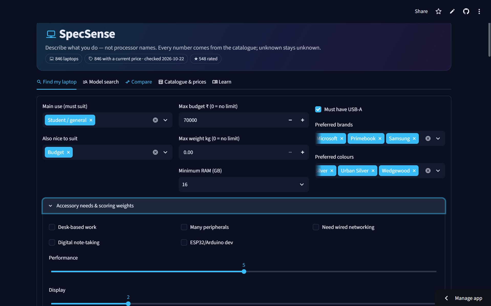
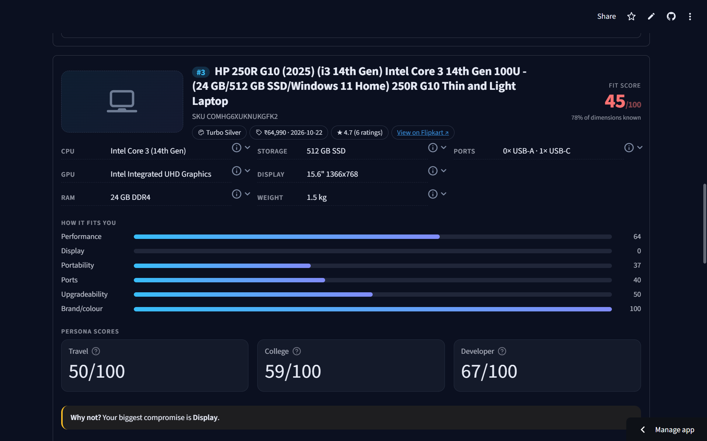

# SpecSense — RAG-powered laptop recommender

SpecSense recommends laptops sold in India from what you'll use the laptop for, your budget and your hard requirements. Every recommendation comes with evidence: the laptop's own structured specs and passages pulled from a curated hardware knowledge base. It never makes claims it can't back up, and it treats a missing spec as **unknown**, never as 0.

Built as a Semester V RAG (Retrieval-Augmented Generation) project.

## Screenshots

**Describe your needs**: workloads, budget, RAM, ports, preferred brands and colours.



**Get an explained pick**: fit score, per-dimension fit, persona scores and the biggest compromise.



## Features

- **Find my laptop**: pick workloads (coding, gaming, ML/DL, CAD, content creation, student, business, budget), a budget, a weight limit, RAM, ports and OS. You get a ranked shortlist with trade-offs, the biggest compromise for each laptop, and the knowledge-base passages behind it.
- **Model search, Compare, Catalogue & prices, Learn**: search the catalogue, compare models side by side, browse prices, and read the knowledge base.
- **Accessory intelligence**: suggests Essential / Recommended / Optional accessories (hubs, docks, cooling pads and so on) only when a laptop's specs and box contents actually leave a gap, then adds them to a "total setup cost".
- **Persona scores**: Travel, College and similar 0–100 scores. A score is shown only when at least 50% of its signals are known.
- **Data pipeline**: polite Amazon.in and Flipkart scrapers, validated CSV importers, and an optional live price refresh.

## How it works

The recommendation pipeline is in [recommendation_engine.py](recommendation_engine.py):

| Stage | What it does |
|---|---|
| A. Hard filter | Rejects laptops that miss the budget, weight, RAM, ports, OS or workload requirements, and records why |
| B. Fit scoring | Weighted score across performance, display, portability, connectivity, upgradeability, service and brand/colour |
| C. RAG evidence | Retrieves supporting chunks from the Chroma knowledge base |
| D. Diversity rerank | Picks the top 3–5 without near-duplicates |
| E. Explanation | Builds trade-off text using only the retrieved evidence and the laptop's specs |

**Retrieval:** the markdown files in [knowledge_base/](knowledge_base/) are chunked and embedded, then stored in ChromaDB with citation metadata (source doc, collection, confidence, dates). Embeddings currently come from a TF-IDF vectorizer, which runs offline. To use real embeddings, swap `embed_chunks()` in [ingest_kb.py](ingest_kb.py) for `sentence-transformers` or an embedding API; nothing else in the pipeline needs to change.

## Project structure

```
app.py                    Streamlit frontend
api.py                    Facade over the engines, used by the frontend
recommendation_engine.py  Stages A–E
accessory_engine.py       Accessory suggestions and total setup cost
scores.py                 Persona scores
ingest_kb.py              Builds the vector store from knowledge_base/
query_kb.py               Retrieval demo from the command line
scrape_amazon.py          Amazon.in scraper (listing + specs, resumable)
scrape_flipkart.py        Flipkart scraper (sitemap landing pages + specs)
import_flipkart.py        Flipkart CSV -> catalogue
import_catalogue.py       Validated bulk import of SKUs
import_prices.py          Validated bulk price import
price_refresh.py          Live price refresh through Google Custom Search
fetch_images.py           Downloads official product images
migrate_p0.py             Adds newer schema columns (safe to re-run)
test_scrapers.py          Offline parser tests
data/specsense.db         SQLite laptop catalogue
knowledge_base/           Markdown KB: glossary, workloads, buying guide, accessories
vector_store/chroma_db/   Prebuilt Chroma index + fitted vectorizer
.streamlit/config.toml    Dark theme
```

## Getting started

You need Python 3.10 or newer.

```bash
git clone https://github.com/kpr3306-lab/Spec-Sense-RAG-Project.git
cd Spec-Sense-RAG-Project
python -m venv venv
# Windows: venv\Scripts\activate    macOS/Linux: source venv/bin/activate
pip install -r requirements.txt
streamlit run app.py
```

The repo already includes the catalogue database and the vector store, so the app runs right away. If the knowledge base can't be loaded, recommendations still work, just without evidence passages.

To allow price editing in the UI, set `SPECSENSE_EDIT=1` (`set SPECSENSE_EDIT=1` on Windows). Leave it off for public deployments.

## Common tasks

```bash
# Rebuild the vector store after editing knowledge_base/
python ingest_kb.py

# Try retrieval and the recommender from the command line
python query_kb.py
python recommendation_engine.py

# Refresh the Flipkart catalogue
python scrape_flipkart.py                 # 1. listing pages
python scrape_flipkart.py --specs         # 2. product-page specs
python import_flipkart.py                 # report only
python import_flipkart.py --apply         # write to data/specsense.db

# Bulk imports (always validate first, then add --apply)
python import_catalogue.py new_skus.csv
python import_prices.py prices.csv        # columns: sku_id, price_inr, retailer, url, observed_date, note

# Live prices (needs GOOGLE_API_KEY and GOOGLE_CSE_ID; see the docstring in price_refresh.py)
python price_refresh.py --dry-run
python price_refresh.py --limit 20

# Tests (offline, no network)
python test_scrapers.py
```

## Adding knowledge

Each knowledge-base file is markdown with front-matter:

```markdown
---
collection: workload_requirements
doc_id: workload_gaming
source_type: internal_authored
source_date: 2026-09-24
last_verified_date: 2026-09-24
confidence: medium
---

## Gaming
...
```

Use `##` headings to separate sections, because each section becomes a retrieval chunk with its own citation. Run `python ingest_kb.py` afterwards.

## Data and limitations

- The catalogue currently holds **846 laptops scraped from Flipkart** (October 2026). Prices are a snapshot and change often.
- Specs come only from listing titles and spec tables. Anything not stated is stored as `NULL` and shown as "unknown".
- Accessory prices in `accessory_engine.py` are illustrative, not live.
- `price_refresh.py` parses ₹ amounts from search snippets, so it can sometimes pick up the wrong number.
- **Scraping:** the scrapers respect `robots.txt`, send one request at a time with long delays, and stop at bot challenges instead of bypassing them. Flipkart's and Amazon's Terms of Use still forbid scraping, so keep runs small and use the data only for personal or academic work. Product images belong to their manufacturers.
